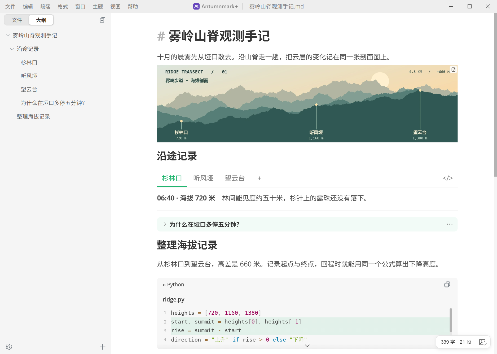

<p align="center"></p>

<h1 align="center">AutumnMark+ · 秋笺</h1>

秋笺是一款开源桌面 Markdown 编辑器。写教程时，可以让读者切换不同平台的步骤，把补充说明折起来，在代码里点出关键几行。插图也能直接存进同一份 `.md`，离线打开或发给别人都不需要图床。

[访问官网](https://autumn-one.github.io/autumnmark/) · [下载正式版](https://github.com/small32/Autumnmark/releases/latest) · [查看发布记录](https://github.com/small32/Autumnmark/releases)

<!-- 上一条“访问官网”链接指向上游仓库（Autumn-one/autumnmark）的站点，本仓库未部署官网。 -->



[查看截图中的示例 Markdown](docs/examples/ridge-notes.md) · [在官网切换浅色、源码和深色视图](https://autumn-one.github.io/autumnmark/#preview)

## 同一份 Markdown，在其他编辑器里怎样显示？

四项扩展都支持**渐进回退**。秋笺把交互加在 Markdown 的标题、段落、图片和代码围栏上。用其他编辑器打开同一份文件，阅读效果取决于该编辑器支持的语法。

| 功能           | 在秋笺里                                                        | 在其他 Markdown 编辑器里                                                                                                        |
| -------------- | --------------------------------------------------------------- | ------------------------------------------------------------------------------------------------------------------------------- |
| 多选项卡       | 点击「杉林口」「听风垭」「望云台」，切换到对应的观测记录。      | 三个地点以带 `\|` 的小标题依次出现，每一段记录都能读到。                                                                        |
| 单文件内嵌图片 | 粘贴海拔图后，图片数据随 `.md` 一起保存。分享时只需这一个文件。 | 允许 `data:` 图片的阅读器可直接离线显示。遇到过滤内嵌图片的平台，可在秋笺中右键「转换为本地图片」，把生成的图片与文档一起发布。 |
| 折叠块         | 点开「为什么在垭口多停五分钟？」查看说明，再点一次收起。        | 折叠标记是 HTML 注释，标题和整段说明按原顺序显示。                                                                              |
| 代码块标注     | 在代码上方显示文件名，高亮指定行，还能限制长代码的预览高度。    | 阅读器按普通围栏代码块显示完整源码。标题、行高亮和预览高度取决于阅读器支持。                                                    |

## 自己写一段试试

### 多选项卡

输入 `/tabs` 插入一组内容选项卡，用 `+` 添加标签。也可以直接写 Markdown。组内以 `| ` 开头的标题就是标签名，后面的段落、列表或代码属于这个标签。

```markdown
<!-- tabs -->

#### | 杉林口

06:40，杉林里仍有薄雾。

#### | 听风垭

07:25，西侧山脊已经见光。

<!-- /tabs -->
```

### 单文件内嵌图片

在「偏好设置 → 图片与导出」选择「嵌入 Markdown（Base64）」，然后粘贴截图或插入图片。图片仍使用 `` 的写法，地址里存着图片本身。上图的海拔剖面就保存在示例文件里，断开网络也能查看。

### 折叠块

输入 `/折叠`，或用两行独立注释包住标题和正文。默认收起。想让读者先看到正文，可把开头改为 `<!-- fold open -->`。

```markdown
<!-- fold -->

### 为什么在垭口多停五分钟？

间隔一分钟拍一张照片，就能看出雾线移动的方向。

<!-- /fold -->
```

### 代码块标题、行高亮与预览高度

在围栏首行写 `title="ridge.py"` 指定文件名，用 `{2-3}` 高亮第 2、3 行，`max-lines=4` 让代码块先显示四行。滚动或展开即可读完，复制代码会得到整个片段。

````markdown
```python title="ridge.py" {2-3} max-lines=4
heights = [720, 1160, 1380]
start, summit = heights[0], heights[-1]
rise = summit - start
direction = "上升" if rise > 0 else "下降"

print(f"{direction} {abs(rise)} 米")
```
````

[完整扩展语法](https://github.com/small32/Autumnmark/blob/develop/packages/website/content/docs/end-user/MARKDOWN_SYNTAX.md#content-tabs) · [图片嵌入与转换](https://github.com/small32/Autumnmark/blob/develop/packages/website/content/docs/end-user/IMAGES.md#embed-in-markdown-base64)

## 下载与开发

正式版提供 Windows x64、macOS ARM64（Apple 芯片）和 Linux x64 安装包。编辑器支持可视化和源码编辑、数学公式、Mermaid 图表，以及 HTML 和 PDF 导出。[下载安装包](https://github.com/small32/Autumnmark/releases/latest)

从仓库根目录运行 `pnpm install` 安装依赖，再用 `pnpm run dev` 启动桌面端。Windows x64 安装包可用 `pnpm run build:win:x64` 构建。[贡献指南](.github/CONTRIBUTING.md)

## 上游与许可

秋笺基于 MarkText 构建，感谢上游作者和贡献者。项目采用 MIT 许可证。[MarkText](https://github.com/marktext/marktext) · [上游贡献者](https://github.com/marktext/marktext/graphs/contributors) · [上游 README 译本](docs/i18n/) · [MIT 许可证](LICENSE)

<details>
<summary>MarkText 上游赞助信息</summary>

**Special Sponsor**

<table>
<tr>
<td width="182"><a href="https://serpapi.com/?utm_source=marktext"></a></td>
<td align="left"><a href="https://serpapi.com/?utm_source=marktext">Scrape Google and other search engines from our fast, easy, and complete API.</a></td>
</tr>
</table>

<!-- current-sponsors:start -->

**Current Public Sponsors (1)**

[](https://github.com/sponsors/marktext)

Only active, public GitHub sponsors are listed here. Thank you to our private sponsors as well.

<!-- current-sponsors:end -->

</details>
